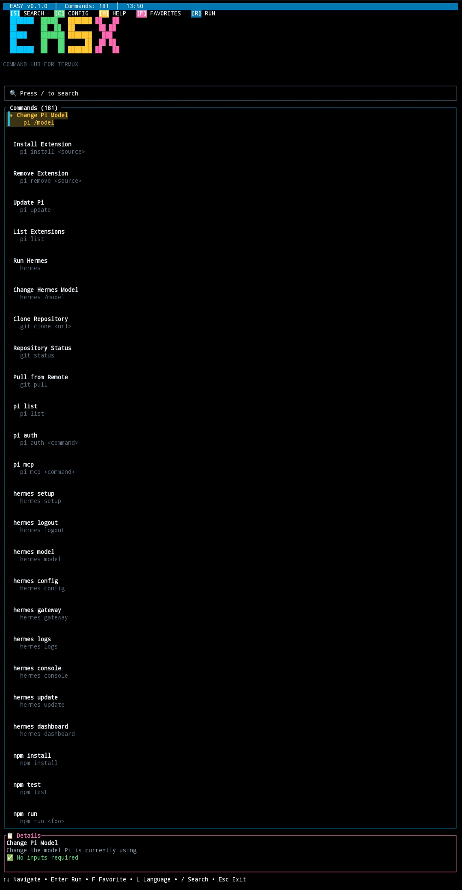
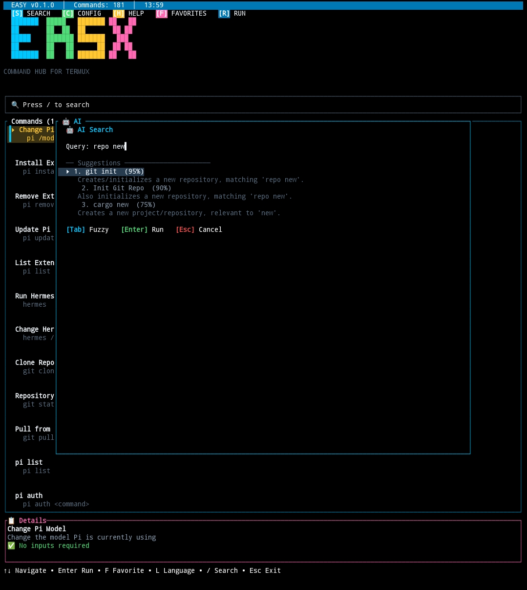
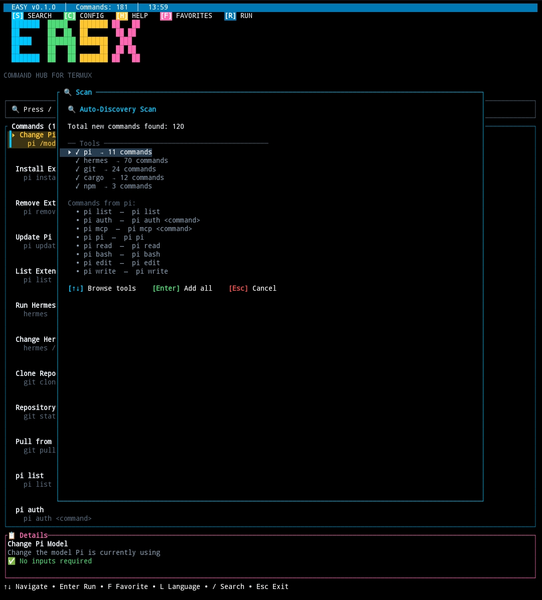

# Easy

<pre>
<span style="color:#00C8FF">███████</span> <span style="color:#50DC78">█████ </span> <span style="color:#FFC832">███████</span> <span style="color:#FF69B4">██   ██</span>
<span style="color:#00C8FF">██     </span> <span style="color:#50DC78">██  ██</span> <span style="color:#FFC832">██     </span> <span style="color:#FF69B4"> ██ ██ </span>
<span style="color:#00C8FF">█████  </span> <span style="color:#50DC78">███████</span> <span style="color:#FFC832">███████</span> <span style="color:#FF69B4">  ███  </span>
<span style="color:#00C8FF">██     </span> <span style="color:#50DC78">██   ██</span> <span style="color:#FFC832">     ██</span> <span style="color:#FF69B4"> ██ ██ </span>
<span style="color:#00C8FF">███████</span> <span style="color:#50DC78">██   ██</span> <span style="color:#FFC832">███████</span> <span style="color:#FF69B4">██   ██</span>
</pre>

**Easy** هو مدير أوامر ذكي يعمل في الطرفية (Terminal)، يجمع أوامرك وأدواتك اليومية في مكان واحد، ويوفر لك بحثًا فوريًا بالذكاء الاصطناعي.

**Easy** is a smart terminal command manager that gathers your everyday commands and tools in one place, with instant AI-powered search.

---

## المميزات / Features

### بالعربية

- 🗂️ **كتالوج أوامر مركزي**: كل أوامرك وأدواتك في قاعدة بيانات واحدة.
- 🤖 **بحث بالذكاء الاصطناعي**: اسأل بأسلوب طبيعي (مثل "كيف أحذف ملف؟") واحصل على أفضل الأوامر المناسبة.
- 🔍 **بحث فوري**: فلترة سريعة بالأسماء والأوصاف والوسوم.
- ⚙️ **تنفيذ مباشر**: شغّل الأوامر من داخل Easy مع عرض النتائج فورًا.
- 📡 **ماسح أوامر**: يكتشف الأوامر المتوفرة في جهازك ويقترح إضافتها.
- ➕ **إضافة أوامر بسهولة**: نموذج بسيط لإضافة أوامر جديدة مع الوصف والوسوم.
- 🇸🇦 🇺🇸 **دوليتان**: واجهة بالعربية والإنجليزية.
- 📱 **مصمم لـ Termux**: خفيف ويعمل على أندرويد بدون إنترنت لواجهة الاستخدام.

### In English

- 🗂️ **Central command catalog**: all your commands in a single database.
- 🤖 **AI search**: ask in natural language (e.g. "how do I delete a file?") and get the best matching commands.
- 🔍 **Instant filtering**: fast fuzzy search by name, description, and tags.
- ⚙️ **Direct execution**: run commands from within Easy and see results immediately.
- 📡 **Command scanner**: discovers commands available on your device and suggests adding them.
- ➕ **Easy command adding**: a simple form for adding new commands with descriptions and tags.
- 🇸🇦 🇺🇸 **Bilingual**: Arabic and English interface.
- 📱 **Built for Termux**: lightweight and works on Android.

---

## Screenshots / لقطات الشاشة

### 🖥️ Main Screen / الشاشة الرئيسية


### 🤖 AI Search / البحث بالذكاء الاصطناعي


### 🔍 Auto-Discovery Scanner / الماسح التلقائي


**ملاحظة:** إذا لم تظهر أي صورة، فهي قيد الإضافة / If any image is missing, it is being added.

---

## المتطلبات / Requirements

- **Rust** (1.70 أو أحدث / 1.70 or newer)
- **Termux** على أندرويد / **Termux** on Android
- اتصال إنترنت لخاصية البحث بالذكاء الاصطناعي / Internet connection for AI search

---

## التثبيت / Installation

```bash
# 1) Clone the repository
git clone https://github.com/your-username/easy.git
cd easy

# 2) Build
cargo build --release

# 3) Run
./target/release/easy
```

> 💡 To make it available everywhere, copy the binary:
>
> ```bash
> cp target/release/easy ~/.local/bin/
> ```

---

## الاستخدام / Usage

### Keybindings

| Key | Action |
|-----|--------|
| `j` / `↓` | Move down |
| `k` / `↑` | Move up |
| `/` | Enter search mode |
| `a` | AI Search dialog |
| `s` | Command scanner |
| `add` | Add a new command |
| `Enter` | Execute selected command |
| `q` | Quit |
| `Esc` | Close dialog / cancel |
| `Ctrl+c` | Copy output to clipboard |

### AI Search example

```
> a                    (open AI Search)
> كيف أحذف ملف؟        (type your question, press Enter)

  ⣾  Asking AI... please wait

  ── Suggestions ─────────────────────
  > 1. rm file.txt         score 0.95
    2. unlink file.txt      score 0.80
```

---

## الإعدادات / Configuration

| File | Purpose |
|------|---------|
| `~/.config/easy/commands.json` | Command catalog (auto-created on first run) |
| `~/.pi/agent/` | AI provider configuration (models, keys) |

- The catalog is stored as JSON — you can edit it manually.
- AI search settings (model, endpoint) are configured in the `src/ai` module constants.

---

## كيف يعمل / How It Works

1. **Scanner** (`src/scanner`): walks your `$PATH` and `~/.local/bin`, detecting executable commands and suggesting them for the catalog.
2. **AI module** (`src/ai`): sends your natural-language query (plus a compact command catalog) to an LLM endpoint and receives the top 3 matches with reasons and scores.
3. **Executor** (`src/executor`): runs the chosen command via the shell, captures stdout/stderr/exit code, and displays it in an output dialog.

```
Scanner ──▶ Catalog (commands.json) ──▶ AI Search ──▶ Executor ──▶ Output
```

---

## الرخصة / License

MIT License — see [LICENSE](LICENSE) for details.

---

## الشكر / Credits

- Built with **Rust** and **Ratatui**
- Terminal interface by [Termux](https://termux.dev/)
- Powered by the **Pi** agent ecosystem
